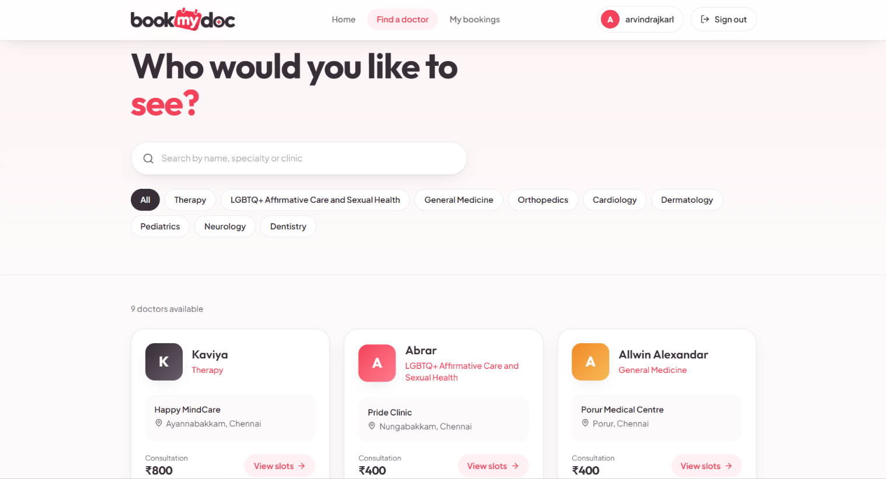
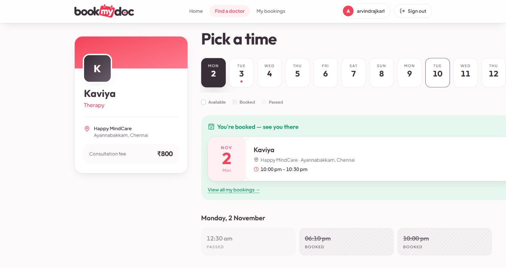
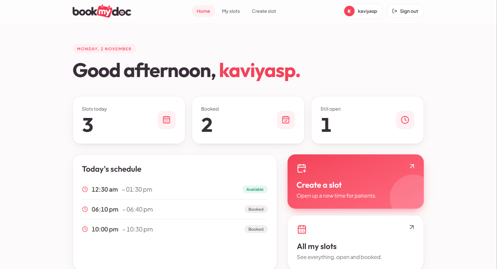
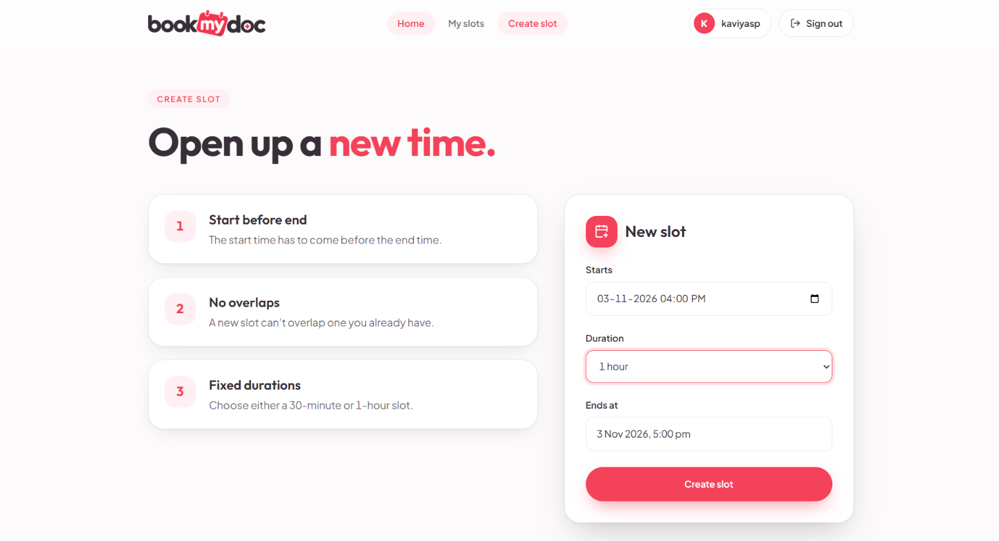
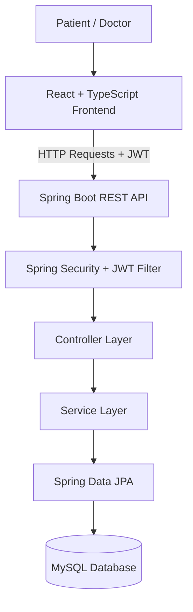

# BookMyDoc – Doctor Appointment Booking System

A full-stack doctor appointment booking application built using **React, TypeScript, Java, Spring Boot, and MySQL**.

BookMyDoc provides a platform where patients can discover doctors, explore available appointment slots, and book consultations. Doctors can manage their availability by creating appointment slots and viewing their appointments.

The project was built to gain practical experience in full-stack application development, REST API integration, authentication, database design, and backend business logic.

## Application Screenshots

### Patient Experience

**Browse Doctors**

Explore the available doctors and their information.



**Doctor Details**

View doctor information, clinic details, consultation fees, and available appointment slots.



### Doctor Experience

**Doctor Dashboard**

View appointment and availability information.



**Create Appointment Slots**

Create appointment slots by selecting a start time and duration.



## Features

### Patient

- Register and log in.
- Browse available doctors.
- View doctor profiles and clinic information.
- Check available appointment slots.
- Book appointments.
- View personal bookings.

### Doctor

- Log in to the doctor dashboard.
- Create appointment slots.
- Select appointment start times and durations.
- View created slots.
- View appointment and availability information.

### Authentication and Security

- JWT-based authentication.
- Stateless authentication using Spring Security.
- Password hashing using BCrypt.
- Protected API endpoints.
- Authenticated user context for doctor-specific operations.

## Technology Stack

| Layer | Technologies |
|---|---|
| Frontend | React, TypeScript, Vite |
| Styling | Tailwind CSS |
| Backend | Java, Spring Boot |
| Security | Spring Security, JWT, BCrypt |
| Database | MySQL 8 |
| Persistence | Spring Data JPA, Hibernate |
| API | REST |
| Build Tool | Maven |
| Version Control | Git, GitHub |

## Application Architecture

BookMyDoc follows a client-server architecture. The React frontend communicates with the Spring Boot backend through REST APIs, while MySQL handles persistent data storage.



### Request Flow

1. Patients and doctors interact with the React frontend.
2. The frontend sends HTTP requests to the Spring Boot backend.
3. Authenticated requests include a JWT in the Authorization header.
4. Spring Security processes authentication before requests reach the application.
5. Controllers handle incoming requests and delegate operations to service classes.
6. Spring Data JPA manages database interactions.

## Key Engineering Implementations

### 1. JWT Authentication

The application uses Spring Security and JSON Web Tokens for stateless authentication.

After successful login, the backend generates a JWT. The frontend includes this token in subsequent authenticated API requests.

Passwords are hashed using BCrypt instead of being stored as plain text.

### 2. Appointment Slot Management

Doctors can create appointment slots by specifying a start time and duration. The frontend calculates the corresponding end time.

The backend validates that the start time is before the end time and checks for overlapping slots before saving a new slot. Conflicting slot creation requests are rejected.

### 3. Relational Database Design

The application uses Spring Data JPA and Hibernate to map Java entities to MySQL tables.

The main entities are:

| Entity | Responsibility |
|---|---|
| User | Stores account and authentication information |
| DoctorProfile | Stores doctor-specific information |
| Slot | Stores doctor appointment availability |
| Booking | Connects a patient with a booked slot |

### Database Relationships

- **User → DoctorProfile:** One-to-one relationship.
- **Doctor → Slot:** One-to-many relationship.
- **Patient → Booking:** One-to-many relationship.
- **Slot → Booking:** One-to-one relationship.

A unique constraint on the booking's slot relationship prevents multiple bookings from being associated with the same slot.

## API Overview

The frontend communicates with the backend through REST endpoints.

| Method | Endpoint | Purpose |
|---|---|---|
| POST | `/api/auth/register` | Register a patient |
| POST | `/api/auth/login` | Authenticate a user |
| GET | `/api/doctors/doctors` | Retrieve doctors |
| GET | `/api/doctors/{id}/allslots` | Retrieve a doctor's slots |
| GET | `/api/doctors/mySlots` | Retrieve the authenticated doctor's slots |
| POST | `/api/slots` | Create an appointment slot |
| POST | `/api/bookings` | Create an appointment booking |
| GET | `/api/bookings/mybookings` | Retrieve the authenticated patient's bookings |

## Project Structure

```text
BookMyDoc/
├── src/
│   └── main/
│       ├── java/com/karl/BookMyDoc/
│       │   ├── controller/
│       │   ├── service/
│       │   ├── repository/
│       │   ├── entity/
│       │   ├── dto/
│       │   ├── security/
│       │   └── enums/
│       └── resources/
│           └── application.properties
│
├── frontend/
│   ├── src/
│   │   ├── components/
│   │   ├── pages/
│   │   ├── api.ts
│   │   └── ...
│   ├── package.json
│   └── vite.config.ts
│
├── docs/
│   └── images/
│       ├── browse-doctors.png
│       ├── doctor-details.png
│       ├── doctor-dashboard.png
│       └── create-slot.png
│
├── pom.xml
└── README.md
```

## Getting Started

Follow these steps to run BookMyDoc locally.

## Demo Accounts

BookMyDoc supports two types of users: Patients and Doctors.

### Patient Account

Patients can register directly through the application's registration page and log in using their registered credentials.

### Doctor Accounts

Doctor accounts are seeded manually into the database using the provided SQL script.

To populate the seven sample doctor accounts, execute:

`docs/demo-data.sql`

### Prerequisites

Make sure you have the following installed:

- Java version required by the project.
- Maven.
- Node.js and npm.
- MySQL 8.
- Git.

### 1. Clone the Repository

```bash
git clone <https://github.com/karl2603/BookMyDoctor>
cd BookMyDoc
```

### 2. Set Up the Database

Create a MySQL database:

```sql
CREATE DATABASE BookMyDoc;
```

### 3. Configure the Backend

Open:

`src/main/resources/application.properties`

Configure your local database connection:

```properties
spring.datasource.url=jdbc:mysql://localhost:3306/BookMyDoc
spring.datasource.username=YOUR_DB_USERNAME
spring.datasource.password=YOUR_DB_PASSWORD

spring.jpa.hibernate.ddl-auto=update
spring.jpa.show-sql=true
```

Use your own database credentials. Do not commit passwords, JWT secrets, or other sensitive configuration to GitHub.

### 4. Run the Backend

From the project root:

```bash
mvn spring-boot:run
```

The backend runs on port `8080` with the current development configuration.

### 5. Run the Frontend

Open another terminal:

```bash
cd frontend
npm install
npm run dev
```

Open the local URL displayed in your terminal by Vite.

## Future Improvements

Some areas that could be developed further:

- Appointment cancellation and rescheduling.
- Email notifications and booking confirmations.
- Doctor profile editing.
- Improved doctor search and filtering.
- Automated frontend and backend testing.
- Production deployment and monitoring.

## What This Project Covers

Building BookMyDoc provided practical experience in:

- Developing a frontend using React and TypeScript.
- Building REST APIs using Java and Spring Boot.
- Implementing JWT authentication and Spring Security.
- Designing relational database models using MySQL.
- Working with JPA and Hibernate.
- Implementing backend validation and business logic.
- Integrating a frontend application with a backend API.
- Managing source code and collaboration using Git and GitHub.

---

**Built with React, TypeScript, Java, Spring Boot, and MySQL.**
